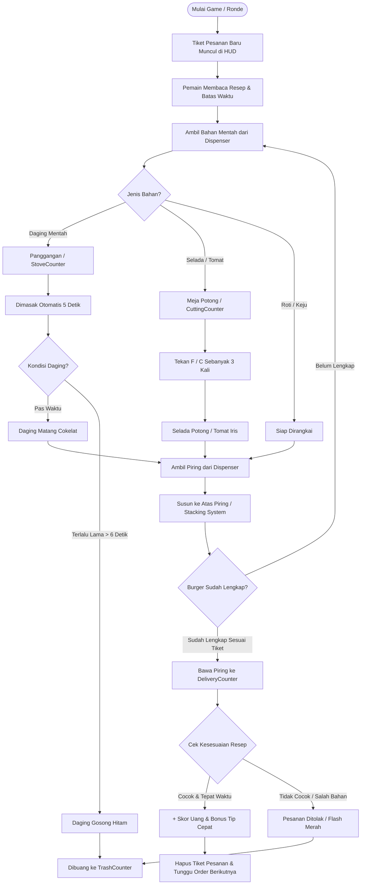
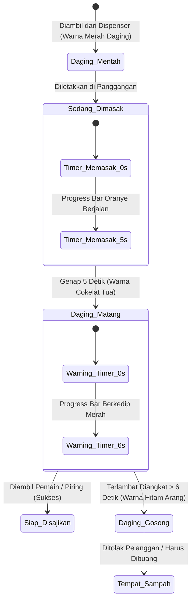
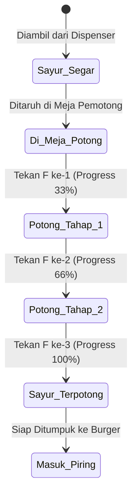
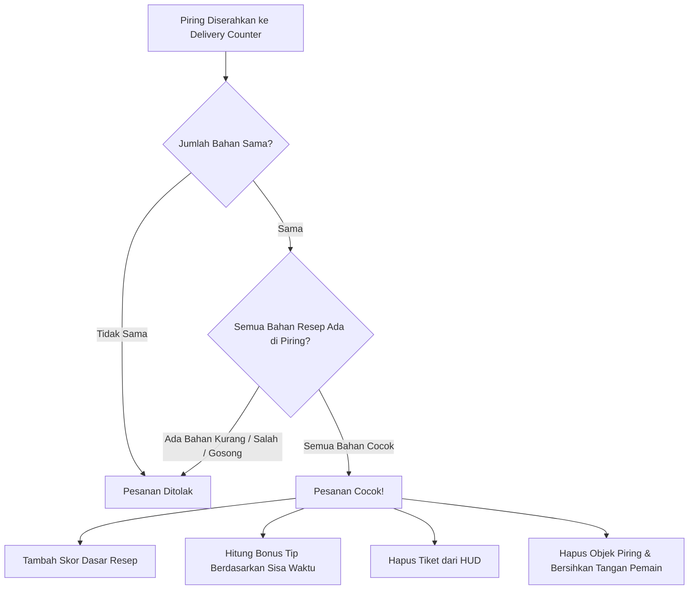
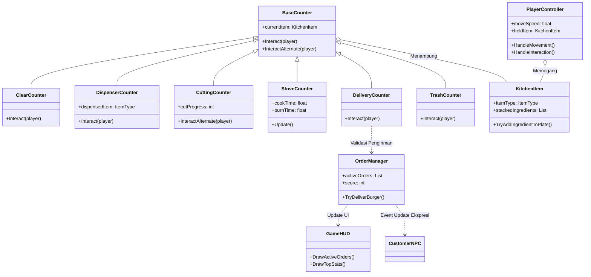

# 🍔 Logika & Alur Permainan: Burger Cooking Game

Dokumen ini menjelaskan seluruh **arsitektur logika, kemampuan pemain, alur pengolahan bahan, dan mekanisme sistem pesanan** pada game memasak burger 2D.

---

## 1. Alur Utama Permainan (Core Game Loop)

Berikut adalah diagram alir (*flowchart*) siklus permainan dari saat pesanan masuk hingga burger berhasil disajikan:



---

## 2. Aksi & Kemampuan Pemain (Player Capabilities)

Semua aksi pemain dikontrol melalui skrip [`PlayerController.cs`](file:///d:/eksperimen/Unity/gameNihKyanya/Assets/Scripts/Player/PlayerController.cs):

| Aksi | Tombol Utama | Tombol Alternatif | Konteks & Logika Interaksi |
|---|---|---|---|
| **Pergerakan** | `W, A, S, D` | `Tombol Panah` | Bergerak 2D Top-Down secara halus. Karakter akan otomatis membalik (*flip*) arah menghadap kiri/kanan. |
| **Interaksi Utama** | `Spasi` | `E` | • **Tangan kosong ke Dispenser:** Mengambil bahan.<br/>• **Pegang item ke Meja Kosong:** Meletakkan item di meja.<br/>• **Tangan kosong ke Meja berisi item:** Mengambil item dari meja.<br/>• **Pegang Piring ke Meja/Kompor:** Menyerap bahan matang langsung ke piring.<br/>• **Pegang Daging ke Kompor:** Memulai proses memanggang.<br/>• **Pegang Burger Lengkap ke Delivery:** Menyerahkan pesanan. |
| **Aksi Potong (*Chop*)** | `F` | `C` | Berdiri di depan Meja Pemotong ([`CuttingCounter.cs`](file:///d:/eksperimen/Unity/gameNihKyanya/Assets/Scripts/Cooking/CuttingCounter.cs)), tekan untuk memotong sayuran bertahap hingga progress bar penuh. |
| **Buang Bahan** | `Q` | - | Membuang item yang sedang digenggam secara instan (atau bisa menaruhnya ke [`TrashCounter.cs`](file:///d:/eksperimen/Unity/gameNihKyanya/Assets/Scripts/Cooking/TrashCounter.cs)). |
| **Restart Game** | `R` | - | Mengulang ronde permainan dari awal. |

---

## 3. Logika Pengolahan Bahan Makanan

### A. State Diagram Pematangan Daging ([`StoveCounter.cs`](file:///d:/eksperimen/Unity/gameNihKyanya/Assets/Scripts/Cooking/StoveCounter.cs))

Daging memiliki 3 tahapan pematangan dengan batas toleransi waktu:



---

### B. State Diagram Pemotongan Sayuran ([`CuttingCounter.cs`](file:///d:/eksperimen/Unity/gameNihKyanya/Assets/Scripts/Cooking/CuttingCounter.cs))

Sayuran segar (Selada & Tomat) harus dipotong agar bisa dimasukkan ke dalam resep burger:



---

## 4. Logika Penumpukan Burger (*Stacking System*)

Diatur dalam [`KitchenItem.cs`](file:///d:/eksperimen/Unity/gameNihKyanya/Assets/Scripts/Cooking/KitchenItem.cs):

```
       [ Roti Atas (RA) ]        ← Penutup Burger
      [ Tomat Iris (TM) ]        ← Sayuran Segar
     [ Selada Potong (SL) ]      ← Sayuran Segar
        [ Keju (KJ) ]            ← Lapisan Keju
     [ Daging Matang (DG) ]      ← Patty Daging
      [ Roti Bawah (RB) ]        ← Alas Burger
   =========================
       [  PIRING PUTIH  ]        ← Dudukan Utama (Plate)
```

* **Mekanisme Penyerapan:** Piring dapat menyerap bahan baik saat ditaruh di meja maupun saat sedang digendong pemain.
* **Lapisan Visual:** Setiap bahan yang ditambahkan akan otomatis diinstansiasi secara hierarkis ke atas dengan ketebalan offset visual (`currentY += 0.10f`).

### 🗺️ Peta Layout Dapur (Semua 4 Sudut Dikosongkan)

Keempat sudut dapur dibuat **100% kosong**, sehingga pemain dapat bergerak leluasa dari segala arah tanpa terjepit sudut, dan **Roti Bawah & Roti Atas diletakkan berdampingan**:

```
[KOSONG]   [ROTI BAWAH] [ROTI ATAS] [DAGING] [KOMPOR 1] [KOMPOR 2] [POTONG] [SELADA]   [KOSONG]
(Sudut TL)                                                                             (Sudut TR)

[PIRING]                                                                               [TOMAT]
[KEJU]                           (AREA GERAK PEMAIN)                                   [KASIR SAJI]
[MEJA PREP]                                                                            [SAMPAH]

[KOSONG]   [MEJA PREP]  [MEJA PREP] [MEJA PREP] [MEJA TENGAH] [MEJA PREP] [KASIR 2]    [KOSONG]
(Sudut BL)                                                                             (Sudut BR)
```

---

## 5. Logika Pencocokan Pesanan & Skor ([`OrderManager.cs`](file:///d:/eksperimen/Unity/gameNihKyanya/Assets/Scripts/Core/OrderManager.cs))



---

## 6. Daftar Resep & Skor

| Menu | Komposisi Bahan | Skor Dasar | Tingkat Kesulitan |
|---|---|---|---|
| **Burger Biasa** | Roti Bawah + Daging Matang + Roti Atas | **$30** | Mudah |
| **Cheeseburger** | Roti Bawah + Daging Matang + Keju + Roti Atas | **$40** | Sedang |
| **Burger Sayur** | Roti Bawah + Selada Potong + Tomat Iris + Keju + Roti Atas | **$45** | Sedang (Potong 2x) |
| **Burger Spesial Lengkap** | Roti Bawah + Daging Matang + Keju + Selada Potong + Tomat Iris + Roti Atas | **$60** | Tinggi (Panggang + Potong 2x) |

---

## 7. Arsitektur Hubungan Skrip C#



---

## 8. Sistem Ekspresi Pembeli & Bar Kematangan Daging

### A. Karakter Pembeli Dinamis ([`CustomerNPC.cs`](file:///d:/eksperimen/Unity/gameNihKyanya/Assets/Scripts/Cooking/CustomerNPC.cs) & [`GameHUD.cs`](file:///d:/eksperimen/Unity/gameNihKyanya/Assets/Scripts/UI/GameHUD.cs))

Karakter pembeli kini hadir di **Dua Tempat Sekaligus**:
1. **Di HUD Tiket Pesanan (Kiri Atas):** Setiap kartu pesanan memiliki avatar pixel art pembeli dengan status mood teks dan timer bar.
2. **Di Dunia Game (Depan Kasir Saji `X = 6.2, Y = 0.0`):** Pembeli berdiri di luar jendela kasir mengenakan mantel kasual, memiliki balon percakapan menu pesanan, dan bar kesabaran di atas kepalanya.

| Kondisi Waktu | Ekspresi Pembeli | Tampilan Avatar & NPC | Efek Animasi & Reaksi |
|---|---|---|---|
| **> 55% Waktu** | **Senang (Happy)** 😊 | Wajah tersenyum, pipi merona merah muda. | Bernapas naik-turun dengan santai, bar kesabaran berwarna hijau segar. Tip maksimal. |
| **25% - 55% Waktu** | **Cemas (Neutral)** 😐 | Wajah datar dengan butiran keringat dingin. | Menatap cemas ke arah dapur, bar kesabaran berubah kuning tua. |
| **< 25% Waktu** | **MARAH! (Angry)** 😡 | Wajah merah meradang, alis tajam, dahi berurat silang merah. | **Kartu HUD & Karakter NPC bergetar cepat (*shake*)**, balon teks berkedip kemerahan, tanda bahaya pesanan hampir gagal! |
| **Pesanan Berhasil** | **Gembira / Sukses** | Wajah tersenyum ceria. | **Melompat kegirangan** di depan kasir sambil memunculkan teks `YAY! +$XX ❤️`. |
| **Pesanan Hangus** | **Kecewa / Pergi** | Wajah cemberut merah. | Menghentakkan kaki kesal sambil memunculkan teks `HUH! LAMA! 😡`, skor berkurang -$10. |

---

### B. Bar Kematangan Daging Multi-Fase ([`StoveCounter.cs`](file:///d:/eksperimen/Unity/gameNihKyanya/Assets/Scripts/Cooking/StoveCounter.cs))

Bar kematangan mengambang tepat di atas setiap panggangan (*StoveCounter*) dengan bingkai berbingkai ganda dan bayangan teks kontras tinggi:

```
[===================== BAR MEMASAK =====================]
 [Status]  🔥 MEMASAK (65%)  -->  ✓ MATANG! [SIAP]  -->  ⚠️ AWAS GOSONG!
 [Warna]   Oranye -> Hijau   -->  Hijau Zamrud     -->  Kedip Merah-Kuning
 [Patty]   Merah Mentah      -->  Cokelat Sedap    -->  Asap & Hitam Arang
```

1. **Fase Memasak (0 - 5 detik):**
   * Daging mentah mendesis lembut (*sizzle scale effect*).
   * Bar terisi dari kiri ke kanan dengan gradasi warna dari oranye hangat ke hijau.
   * Teks: `MEMASAK (XX%)`.
2. **Fase Matang Sempurna (Siap Disajikan):**
   * Tepat di detik ke-5, daging meletup membesar sesaat (*pop animation* 130%) dan berubah warna menjadi cokelat tua lezat.
   * Bar berubah menjadi hijau zamrud berdenyut halus (*pulsing glow*) dengan teks: `✓ MATANG! [SIAP ANGKAT]`.
   * **Kemudahan Interaksi:** Pemain bisa mengambilnya dengan tangan kosong (`Spasi`) **atau** langsung mendekatkan piring untuk menyerapnya ke tumpukan burger!
3. **Fase Peringatan Gosong (Detik 5 - 10):**
   * Jika pemain tidak segera mengangkat daging, sistem peringatan otomatis aktif.
   * Bar berkedip cepat Merah dan Kuning secara bergantian dengan teks hitung mundur: `! AWAS GOSONG (X.Xs) !`.
   * Daging bergetar menandakan asap panas mengepul.
4. **Fase Gosong:**
   * Di detik ke-10, daging hangus menjadi hitam arang pekat (`PattyBurnt`).
   * Bar menjadi hitam-abu abu dengan teks: `X GOSONG (BUANG KE SAMPAH)`.
   * Daging gosong tidak dapat disajikan ke pelanggan dan harus dibuang ke tempat sampah (`Q` atau `TrashCounter`).

